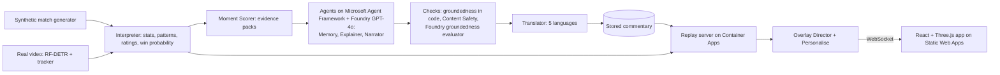

# Seize the game

*Live football intelligence, explained and personalised.*

Seize the game is an AI system that turns live football match events into explainable insights for broadcasters and fans. It reads match data from a synthetic event generator and from computer-vision tracking of match video. Specialist AI agents built on Microsoft Foundry and Microsoft Agent Framework calculate stats and live player ratings, find the key moments, explain why they matter, and present them as on-screen overlays on a live 3D pitch. Each viewer can personalise the experience by club, favourite player, language and level of detail. It runs on Azure.

Built for the Microsoft Premier League Hackathon (October 2026).

The app is named **Seize the game**, with `seize-the-game` used in package and service names. The existing repository URL, Python import path `pitch_insights`, browser storage keys and Azure resource names remain in place for compatibility with the deployed app and saved profiles.

## Try it

**Live app: [blue-moss-06018420f.1.azurestaticapps.net](https://blue-moss-06018420f.1.azurestaticapps.net)** (desktop browser recommended; no sign-in). The first visit starts playing immediately. "Watch demo" applies a favourite player and win-probability preset for this visit; "Personalise" opens the optional profile editor. Playback controls stay above the pitch, with a slider, numeric time entry and replay after full time.

- **[Two viewers, one match](https://blue-moss-06018420f.1.azurestaticapps.net/?compare=1)**: a Potato FC fan watching casually in German beside a Carrot FC analyst in English, on the same replay.
- **[Real footage](https://blue-moss-06018420f.1.azurestaticapps.net/?match=117093-38min_ft&follow=L-t11)**: 100 seconds of a real match, with players tracked from video by a fine-tuned detector, AI commentary that says how sure the detector was, and a spotlight that follows one real player (tap any other to switch).
- **[A personalised link](https://blue-moss-06018420f.1.azurestaticapps.net/?match=comeback-POT-CAR&team=POT&player=POT-11&mode=casual&lang=es&focus=xg)**: any profile can be set from the address bar (`team`, `player`, `mode`, `lang`, `focus`).

**Demo video:** *(link added at submission)*

Picking the project up? Start with [docs/HANDOFF.md](docs/HANDOFF.md).

## What it does

- **Replays a match on a 3D pitch** with live stats, momentum, win probability and player ratings that move with every action.
- **Finds the moments that matter** and explains each one in two voices, casual and analyst, from the computed facts behind it. "Why?" shows those facts.
- **Keeps the screen clean**: an Overlay Director schedules lower-thirds, stat cards, player tags and rating alerts so they never pile up.
- **Personalises per viewer**: favourite club and player (a spotlight follows them on the pitch, with a pinned card and alerts), language (English, Spanish, French, German, Dutch, Simplified Chinese), level of detail and one focus metric.
- **Works on real video too**: players tracked from licensed match footage feed the same app: the agents comment on the detected play (hedging what the detector wasn't sure of), and a viewer can follow any tracked player, whose real position the spotlight rides frame by frame.

## Architecture



The agents run ahead of time and their checked, translated commentary is stored, so the live app never waits on a model and makes no model calls. Everything else runs live per viewer.

## Microsoft and Azure technologies

| Technology | What it does here |
|---|---|
| **Microsoft Agent Framework** | The Explainer, Narrator, Video Narrator and Memory agents, with deterministic orchestration, a retry on failed checks and a fallback headline |
| **Microsoft Foundry** (GPT-4o, `text-embedding-3-small`) | Writes the commentary; embeddings let the Memory agent recall similar earlier moments |
| **Foundry groundedness evaluator** | A second opinion on stored commentary (52 synthetic-match moments and 5 clip passages pass, lowest score 4 of 5 in each set) |
| **Azure AI Content Safety** | Screens every line before it can be shown; fails closed |
| **Azure AI Translator** | Translates every moment into 5 languages, with names and clocks protected and every number checked |
| **Application Insights** (OpenTelemetry) | Traces agent runs (without prompts or replies) and the live server's requests |
| **Azure Machine Learning** (MLflow) | Records the video detector's benchmark runs, pre-trained and fine-tuned |
| **Azure Container Apps** + **Container Registry** | Runs the replay server (WebSocket streaming) |
| **Azure Static Web Apps** | Hosts the app |
| **Azure Cosmos DB** (free tier) | Stores viewer profiles, reached through a managed identity with keys disabled |
| **Azure Key Vault** + **managed identities** | Holds the server's secret; no keys in code, images or GitHub |
| **GitHub Actions** with OpenID Connect | Tests, builds and deploys on every merge, with no stored Azure secret |

## Pipeline

1. **Ingest**: synthetic match events, plus player positions and events derived from real, licensed match video (RF-DETR detection on tiles, ByteTrack-style tracking, a fitted image-to-pitch mapping), in one shared event format.
2. **Interpret**: stats, patterns (momentum, pressure, chaos, tempo) and live player ratings, calculated in code.
3. **Explain**: each moment is scored by how much it changed the match, and explained by agents from an evidence pack of computed facts, with similar earlier moments recalled by the Memory agent.
4. **Render**: timed, machine-readable overlay cues, chosen by the Overlay Director (deterministic rules that keep the screen clean) and drawn over a Three.js 3D pitch.
5. **Personalise**: analyst or casual mode, favourite club and player, language and focus metric, sent with the connection so each viewer gets their own cues.

## Repository layout

| Folder | Contents |
|---|---|
| `backend/` | Python: event generator, video loader and scoring (pure Python), stats, agents, event stream |
| `video/` | The video path's detector and scripts, in their own environment (`video\.venv`: torch CPU, rfdetr, opencv) |
| `frontend/` | Vite + React + Three.js viewer and overlays |
| `docs/` | Plan and design notes |

## Setup

Copy `.env.example` to `.env` and fill in your Azure details.

### Backend (Python 3.12)

```
cd backend
py -3.12 -m venv .venv
.venv\Scripts\activate          # macOS/Linux: source .venv/bin/activate
pip install -e ".[dev]"
```

### Generate a match

```
python -m pitch_insights.generate --seed 42 --home POT --away CAR --out ../data
python -m pitch_insights.watch ../samples/comeback-POT-CAR.jsonl --speed 60 --from 80   # watch it play out
python -m pitch_insights.interpret ../samples/comeback-POT-CAR.jsonl --at 70 --player Madekuta   # stats, ratings, signals
python scripts/seed_search.py --story comeback --home POT --away CAR
python scripts/validate_realism.py      # 300 matches against real-football ranges
pytest                                   # 418 backend tests; no keys or network needed
```

### Run the app

Two terminals:

```
cd backend
.venv\Scripts\python -m uvicorn pitch_insights.server:app --port 8000
```

```
cd frontend
npm install
npm run dev
```

Then open http://localhost:5173. Pick a demo match, switch between casual fan and analyst, change speed, or jump to a minute. `/?compare=1` opens the side-by-side view.

Frontend checks (Node 24, from `frontend/`): `npm test` runs 12 regression tests for player following and appearance preferences; `npm run build` checks TypeScript and builds the app. Selecting a player in Live ratings now updates the favourite, pinned card and spotlight together. In the real-footage clip, select a marker or player row to follow, and use "Stop following" to clear the selection.

Light mode is the default, with a Light/Dark switch under Appearance. The choice is kept in this browser and shared across comparison panes. On phones, Settings holds the viewing options, and tabs switch between moments, players and stats. Momentum and the pitch guide can be expanded when needed.

Ready-made demo matches are in [`samples/`](samples/README.md). The event format is described in [docs/DESIGN.md](docs/DESIGN.md), with JSON Schemas in `docs/schema/`.

## Synthetic data realism

Averages over 300 generated matches (`scripts/validate_realism.py`; full output in [docs/realism-check.txt](docs/realism-check.txt)):

| Stat | Generated | Real-football target |
|---|---|---|
| Passes per team | 554 | 400–600 |
| Pass accuracy | 83.9% | 75–88% |
| Shots per team | 13.5 | 8–18 |
| xG per match | 2.8 | 2.5–3.5 |
| Goals per match | 2.9 | 2.5–3.0 |
| Yellow cards per match | 3.2 | 3–4 |
| Fouls per team | 9.4 | 9–13 |
| Corners per team | 5.0 | 4–7 |
| Penalties per match | 0.3 | 0.2–0.4 |
| Home win / draw / away win | 43 / 24 / 33% | about 45 / 25 / 30% |

Each club's style shows in its numbers: the high-press side makes the most pressures, the possession side has the best pass accuracy, and the direct side plays the longest passes.

## Live player ratings

Every player starts at 6.0 and moves with each action, weighted by position and damped by playing time, and every change is logged so the app can show why a rating is what it is. Over 120 generated matches (`scripts/calibrate_ratings.py`): average 6.8, spread 0.76, best player in a match about 8.5, and 9.5+ in about 10% of matches, in line with public rating systems. Every position averages 6.8–6.9. Details in [docs/DESIGN.md](docs/DESIGN.md#interpret-stage-v1).

## Agents and grounded commentary

The Explainer and Narrator agents, built with Microsoft Agent Framework on a Microsoft Foundry GPT-4o deployment, turn each key moment's evidence pack into commentary in two voices: casual and analyst. A code check confirms that every name and number they write is in the evidence. A draft that fails gets one retry with the problems named, and after that the moment keeps its plain headline. Commentary for the demo matches is generated ahead and stored, so the demo never waits on a model:

```
cd backend
.venv\Scripts\python scripts/generate_commentary.py
```

Every line is then screened by **Azure AI Content Safety** (blocked at the lowest harm level, and not shown if the service can't be reached), and **Foundry's groundedness evaluator** gives a second opinion: all 52 synthetic-match moments and all 5 clip passages pass, the lowest scoring 4 out of 5 in each set. **Azure AI Translator** puts every moment into Spanish, French, German, Dutch and Simplified Chinese, with player and club names and match clocks protected, and a translation that loses a name or number keeps its English (9 of 3,180 did across the synthetic matches). Agent runs are traced to **Application Insights** through Agent Framework's OpenTelemetry instrumentation, without prompts or replies.

```
cd backend
.venv\Scripts\python scripts/translate_moments.py
.venv\Scripts\python scripts/evaluate_groundedness.py
```

First full run: 52 moments across the three demo matches, all grounded, none fell back. Commentary is labelled as AI-generated in the app, and "Why?" shows the facts it came from. Details and the engineering practices we follow: [docs/DESIGN.md](docs/DESIGN.md#agents).

## Overlay Director and personalisation

The **Overlay Director** turns moments, stats and rating changes into timed cues (time, duration, priority, template, data) and keeps the screen clean: one lower-third at a time, at most two cards, cooldowns between similar cues, and a higher-priority cue may replace a lower one. A cue that would arrive too late is dropped rather than shown stale. It is deterministic code, so a replay always looks the same.

**Personalise** takes the viewer's five choices (mode, language, favourite club, favourite player, focus metric) with the connection. Cues about the favourites get a priority boost and a star that says why, the favourite player gets their own alerts (goals, assists, cards, rating jumps), and the other side's minor alerts don't take a fan's screen space. Every goal, red card and the final whistle still reaches everyone: personalising adds emphasis and never hides the match. Profiles hold only those five choices: in the browser, and in Cosmos DB when deployed, with "Clear my profile" in the app.

Details: [docs/DESIGN.md, Overlay Director](docs/DESIGN.md#overlay-director) and [Personalise](docs/DESIGN.md#personalise).

## Responsible AI

- **Grounded:** the agents only explain facts computed in code, a code check confirms every name and number, and "Why?" shows the evidence. A line that fails falls back to the plain headline.
- **Screened:** Azure AI Content Safety checks every line before it can be shown, and nothing unchecked is shown if the service can't be reached.
- **Labelled:** commentary is marked as AI-generated, machine translations are marked, and the real-footage view says its positions come from a model, with the model's measured accuracy and what the numbers don't cover.
- **Private:** no accounts, names or viewing history; a profile is five choices the viewer can clear. Agent traces leave out prompts and replies.
- **Fictional players, real footage with consent:** synthetic clubs and players are invented, and SoccerTrack v2's players are labelled only by side and number.

## Video path: real footage into the same messages

The core pipeline runs on synthetic matches. As a second source, the video path turns real, licensed match video into the same `frame` and `event` messages: [SoccerTrack v2](https://atomscott.github.io/SoccerTrack-v2/) (Scott et al., CC BY 4.0), a fixed 4K panoramic camera over a whole pitch, amateur university players who consented, no names. Players are labelled by side and tracker ID ("Left #7"), never with our fictional names or as shirt numbers.

A dedicated **Video Narrator** agent describes five passages of detected play in casual and analyst voices. Clip-specific checks reject unsupported event types and require hedging below 60% confidence. The app shows this checked, translated commentary alongside tracking estimates for possession, distance and top speed; tap a marker or player row to follow that player's tracked position. The clip has no score or live player ratings.

**RF-DETR** (small) runs on 5 × 2 tiles of each frame: for people, a model fine-tuned on SoccerTrack's own player boxes from the first four minutes of the half (never on the benchmark clip); for the ball, the COCO-pre-trained one. A 2-D polynomial, fitted on frames before the clip, maps feet in the image to pitch metres (one homography can't describe a stitched panorama). A ByteTrack-style tracker works in pitch metres, shirt colours give the teams, and possession of the tracked ball gives passes, carries and turnovers with a `confidence`.

Benchmarked against SoccerTrack's ground truth on 100 s of match 117093 (38:00–39:40, the build-up to a goal, 500 frames at 5 fps):

| | Fine-tuned | Pre-trained |
|---|---|---|
| Players found | 93% | 90% |
| Position error | 0.76 m mean, 0.58 m median | 0.77 m mean, 0.59 m median |
| Precision | 97% | 85% (the rest are officials, who aren't in the ground truth, people behind the goals and spectators the filter missed) |
| Team from shirt colour | 95% | 93% |
| Events matching SoccerTrack's within ±5 s | 79% of ours; 30% of theirs found | 73%; 30% |
| Detection time | 0.47 s a frame on a GPU (AMD RX 9070 XT) | 0.26 s on the GPU, 7.7 s on a laptop CPU |

On SoccerTrack's held-out test frames, fine-tuning lifts box precision from 45% to 98% at the same 98% recall: it learns to ignore spectators and staff.

The team, ID and event settings were chosen on this clip, so those figures are optimistic until checked on another; details, limits and how to run it in [docs/DESIGN.md, Video path](docs/DESIGN.md#video-path). The output is in [`samples/video/`](samples/README.md#video-path-video), and the app replays it as the "real footage" match. The benchmark runs are logged to Azure Machine Learning through MLflow.

## Deployment

The live app runs on Azure in East US 2: the replay server on **Container Apps** (image in **Container Registry**), the app on **Static Web Apps**, viewer profiles in **Cosmos DB**, the server's one secret in **Key Vault**, and telemetry in **Application Insights**. The server reaches Key Vault, Cosmos DB and the registry through a managed identity. GitHub Actions signs in to Azure with OpenID Connect, runs the tests, builds the image and deploys on every merge into `main`. The deployed app replays stored commentary and makes no model calls. Step-by-step setup: [docs/DEPLOY.md](docs/DEPLOY.md); design notes: [docs/DESIGN.md, Deployment](docs/DESIGN.md#deployment-azure).

## Credits

- Player and ball detection: [RF-DETR](https://github.com/roboflow/rf-detr) by Roboflow (Apache-2.0), small model with its pre-trained COCO weights, fine-tuned for people on SoccerTrack v2's boxes
- Video and ground truth for the video path: [SoccerTrack v2](https://atomscott.github.io/SoccerTrack-v2/) by Scott et al. (CC BY 4.0), [arXiv:2508.01802](https://arxiv.org/abs/2508.01802)
- Tracking follows the idea of [ByteTrack](https://arxiv.org/abs/2110.06864) (Zhang et al.); the code is our own
- All clubs, players and matches in the synthetic data are fictional.

## License

[Apache-2.0](LICENSE); see [NOTICE](NOTICE) for third-party work. The repo was AGPL-3.0 while YOLO (Ultralytics) was planned as the detector; it was relicensed on 22 Oct 2026 once RF-DETR (Apache-2.0) replaced it.
