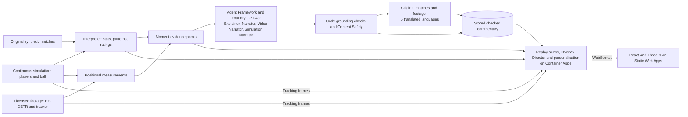

# Seize the game

*Live football intelligence, explained and personalised.*

Seize the game turns football match data into explainable insights for broadcasters and fans. A continuous synthetic simulation tracks all twenty-two players and the ball, alongside three original full-match scenarios and a computer-vision replay of licensed footage. Code calculates statistics, ratings and moment evidence. Specialist writing agents built with Microsoft Agent Framework and Microsoft Foundry explain that evidence in casual and analyst voices. Checked commentary is stored before playback and presented as personalised overlays on a live 3D pitch. The app runs on Azure and makes no model calls during playback.

Built for the Microsoft Premier League Hackathon (October 2026).

The app is named **Seize the game**, with `seize-the-game` used in package and service names. The existing repository URL, Python import path `pitch_insights`, browser storage keys and Azure resource names remain in place for compatibility with the deployed app and saved profiles.

## Try it

**Live app: [blue-moss-06018420f.1.azurestaticapps.net](https://blue-moss-06018420f.1.azurestaticapps.net)** (desktop browser recommended; no sign-in). The first visit starts the six-minute continuous exhibition at normal speed. "Watch demo" returns to it with a favourite-player preset for this visit; "Personalise" opens the optional profile editor. Playback controls include pause, speed, seeking and replay.

- **[Continuous match and formation lines](https://blue-moss-06018420f.1.azurestaticapps.net/?match=continuous-prototype&team=POT&player=POT-07&mode=analyst&lang=en&speed=1)**: follow a player, inspect movement and enable Formation lines for one team in analyst mode. The lines regroup from observed player positions.
- **[Two viewers, one match](https://blue-moss-06018420f.1.azurestaticapps.net/?compare=1&match=comeback-POT-CAR)**: a Potato FC fan watching casually in German beside a Carrot FC analyst in English, on the same original full-match replay.
- **[Real footage](https://blue-moss-06018420f.1.azurestaticapps.net/?match=117093-38min_ft&follow=L-t11)**: 100 seconds of a real match, with players tracked from video by a fine-tuned detector, AI commentary that says how sure the detector was, and a spotlight that follows one real player (tap any other to switch).
- **[A personalised link](https://blue-moss-06018420f.1.azurestaticapps.net/?match=comeback-POT-CAR&team=POT&player=POT-11&mode=casual&lang=es&focus=xg)**: any profile can be set from the address bar (`team`, `player`, `mode`, `lang`, `focus`).

**Demo video:** *(link added at submission)*

For architecture and setup, see [docs/DESIGN.md](docs/DESIGN.md) and [docs/DEPLOY.md](docs/DEPLOY.md). Internal assistant handoffs are kept locally and excluded from Git.

## What it does

- **Tracks continuous movement**: twenty-two players and the ball at five updates a second, with interpolated markers, terrain, shot peaks and goal glows. Original full-match scenarios and tracked real footage remain available.
- **Explores off-ball play**: player following, movement trails, nearby-player rings, camera controls and positional width, depth and proximity measurements. Analyst-only formation lines connect one team's observed outfield depth groups and regroup as players move.
- **Replays statistics and ratings** from computed events. Original full matches include win probability; the six-minute exhibition labels ratings as illustrative and omits full-match predictions. The footage clip shows tracking estimates rather than a score or player ratings.
- **Finds the moments that matter** and explains each one in two voices, casual and analyst, from the computed facts behind it. "Why?" shows those facts.
- **Keeps the screen clean**: an Overlay Director schedules lower-thirds, stat cards, player tags and rating alerts so they never pile up.
- **Personalises per viewer**: favourite club and player, level of detail and one focus metric, with a spotlight, pinned card and relevant alerts. Original full matches and the footage clip have English plus Spanish, French, German, Dutch and Simplified Chinese commentary. The continuous exhibition currently has English commentary only.
- **Offers two surface views**: Current play responds to recent positions; Activity history builds from the viewer's starting or seek point and fades over match time. Pause and seeking share the players' drawing clock.
- **Works on real video too**: players tracked from licensed match footage feed the same app: the agents comment on the detected play (hedging what the detector wasn't sure of), and a viewer can follow any tracked player, whose real position the spotlight rides frame by frame.

## Architecture



Evidence and narration are prepared ahead of playback. The server releases only frames, events and moments due on each viewer's replay clock. Original full matches also use embedding retrieval for similar earlier moments. Foundry's offline groundedness evaluator has been run on the original-match and footage commentary; the continuous narration has code checks and Content Safety results, without those evaluator scores.

## Microsoft and Azure technologies

| Technology | What it does here |
|---|---|
| **Microsoft Agent Framework** | Four writing roles: Explainer, Narrator, Video Narrator and Simulation Narrator, with deterministic routing, one retry on failed grounding checks and a fallback headline |
| **Microsoft Foundry** (GPT-4o, `text-embedding-3-small`) | Writes commentary; a separate deterministic Memory component retrieves similar earlier moments from stored embeddings for original matches |
| **Foundry groundedness evaluator** | A second opinion on stored commentary (52 synthetic-match moments and 5 clip passages pass, lowest score 4 of 5 in each set) |
| **Azure AI Content Safety** | Screens generated commentary before playback; unsafe or unchecked generated text is not shown |
| **Azure AI Translator** | Prepares 5 translated languages for original-match and footage commentary, with protected names and clocks and number checks |
| **Application Insights** (OpenTelemetry) | Traces agent runs without prompts or replies; server traces retain route templates, timings and outcomes without raw URLs, viewer IDs or client IPs |
| **Azure Machine Learning** (MLflow) | Records the video detector's benchmark runs, pre-trained and fine-tuned |
| **Azure Container Apps** + **Container Registry** | Runs the replay server (WebSocket streaming) |
| **Azure Static Web Apps** | Hosts the app |
| **Azure Cosmos DB** (free tier) | Stores viewer profiles, reached through a managed identity with keys disabled |
| **Azure Key Vault** + **managed identities** | Holds the server's telemetry connection string; the backend reaches Azure resources through managed identity |
| **GitHub Actions** | Tests, builds and deploys affected components on merges into main. Backend Azure authentication uses OpenID Connect; frontend publishing uses a Static Web Apps deployment token stored in GitHub Secrets |

## Pipeline

1. **Ingest**: original synthetic match events, continuous player and ball positions with contact-derived actions, and tracking derived from licensed match video, using shared event and frame formats.
2. **Interpret**: code calculates synthetic-match stats, patterns and ratings, while positional evidence builders measure simulation and footage movement. Footage does not pass through the full-match ratings or prediction model.
3. **Explain**: code selects moments and evidence; the appropriate writing agent explains them for casual and analyst audiences. Original matches can include similar earlier moments retrieved by the Memory component.
4. **Render**: timed, machine-readable overlay cues, chosen by the Overlay Director (deterministic rules that keep the screen clean) and drawn over a Three.js 3D pitch.
5. **Personalise**: analyst or casual mode, favourite club and player, language and focus metric, sent with the connection so each viewer gets their own cues.

## Repository layout

| Folder | Contents |
|---|---|
| `backend/` | Python: event generator, video loader and scoring (pure Python), stats, agents, event stream |
| `video/` | The video path's detector and scripts, in their own environment (`video\.venv`: torch CPU, rfdetr, opencv) |
| `frontend/` | Vite + React + Three.js viewer and overlays |
| `docs/` | Plan and design notes |

## Setup

Stored replays and the continuous exhibition run locally without Azure credentials. To generate new AI commentary, translations or evaluations, copy `.env.example` to `.env`, configure the required services, and install the backend's `agents` or `evaluation` extras. Never commit `.env`.

### Backend (Python 3.12)

```
cd backend
py -3.12 -m venv .venv
.venv\Scripts\activate          # macOS/Linux: source .venv/bin/activate
pip install -e .
```

### Generate a match

```
python -m pitch_insights.generate --seed 42 --home POT --away CAR --out ../data
python -m pitch_insights.watch ../samples/comeback-POT-CAR.jsonl --speed 60 --from 80   # watch it play out
python -m pitch_insights.interpret ../samples/comeback-POT-CAR.jsonl --at 70 --player Madekuta   # stats, ratings, signals
python scripts/seed_search.py --story comeback --home POT --away CAR
python scripts/validate_realism.py      # 300 matches against real-football ranges
pip install -e ".[dev]"                 # packages for development and the full test suite
pytest                                   # 443 backend tests; no keys or network needed
```

### Run the app

Two terminals:

```
cd backend
.venv\Scripts\python -m uvicorn pitch_insights.server:app --port 8000
```

```
cd frontend
npm install
npm run dev
```

Then open http://localhost:5173. The continuous exhibition starts by default. Switch matches or audience mode, change speed, or seek to a second in tracking replays and a minute in original full matches. `/?compare=1&match=comeback-POT-CAR` opens a multilingual comparison; `/?compare=1&match=continuous-prototype&speed=1` compares the exhibition in English.

Frontend checks (Node 24, from `frontend/`): `npm test` runs 37 regression tests covering replay, following, terrain, player context, formation lines and appearance; `npm run build` checks TypeScript and builds the app. In original matches, selecting a player in Live ratings updates the favourite, pinned card and spotlight. In the exhibition and footage clip, selecting a marker or player row follows them for that replay without replacing the saved favourite.

Light mode is the default, with a Light/Dark switch under Appearance. The choice is kept in this browser and shared across comparison panes. On phones, Settings holds the viewing options, and tabs switch between moments, players and stats. Momentum and the pitch guide can be expanded when needed.

Ready-made demo matches are in [`samples/`](samples/README.md). The event format is described in [docs/DESIGN.md](docs/DESIGN.md), with JSON Schemas in `docs/schema/`.

## Continuous exhibition

The default match is a seeded six-minute first-half exhibition between Potato FC and Carrot FC. Twenty-two persistent players and the ball are sampled at 5 Hz; passes, interceptions and tackles use the same positions as the replay. Basic kick-offs, goal kicks and goalkeeper possession are modelled. Prepared positional moments and 13 stored, screened Simulation Narrator passages feed the same Overlay Director as the original matches.

Analysts can enable **Formation lines**, off by default, for one selected team. Lines connect the ten outfield players in observed depth groups, with smoothing and a 1.5-second hold before adopting changed membership. They hide during restarts or incomplete observations. The shape is a geometric estimate, not a confirmed tactical formation.

Movement and event rates are illustrative rather than calibrated against a full match. The exhibition has no offside, fouls, cards, substitutions, corners, throw-ins or second half, and no full-match win predictions. Its ratings are labelled illustrative and its commentary is English only. Details: [docs/CONTINUOUS-SIMULATION.md](docs/CONTINUOUS-SIMULATION.md).

## Original synthetic match realism

Averages over 300 generated matches (`scripts/validate_realism.py`; full output in [docs/realism-check.txt](docs/realism-check.txt)):

| Stat | Generated | Real-football target |
|---|---|---|
| Passes per team | 554 | 400–600 |
| Pass accuracy | 83.9% | 75–88% |
| Shots per team | 13.5 | 8–18 |
| xG per match | 2.8 | 2.5–3.5 |
| Goals per match | 2.9 | 2.5–3.0 |
| Yellow cards per match | 3.2 | 3–4 |
| Fouls per team | 9.4 | 9–13 |
| Corners per team | 5.0 | 4–7 |
| Penalties per match | 0.3 | 0.2–0.4 |
| Home win / draw / away win | 43 / 24 / 33% | about 45 / 25 / 30% |

Each club's style shows in its numbers: the high-press side makes the most pressures, the possession side has the best pass accuracy, and the direct side plays the longest passes.

## Live player ratings

For the original full-match generator, every player starts at 6.0 and moves with each action, weighted by position and damped by playing time, with an action breakdown explaining the rating. Over 120 generated matches (`scripts/calibrate_ratings.py`): average 6.8, spread 0.76, best player in a match about 8.5, and 9.5+ in about 10% of matches. Every position averages 6.8–6.9. These calibration figures do not validate the continuous exhibition's illustrative ratings. Details in [docs/DESIGN.md](docs/DESIGN.md#interpret-stage-v1).

## Agents and grounded commentary

Four writing roles use Microsoft Agent Framework with a Foundry GPT-4o deployment: Explainer for major original-match moments, Narrator for match flow, Video Narrator for detected footage, and Simulation Narrator for the exhibition. Deterministic code routes each evidence pack to the appropriate role. Name, number and selected unsupported-claim checks trigger one retry, then a plain fallback headline. These checks do not prove every possible inference is supported. Commentary is generated ahead and stored:

```
cd backend
.venv\Scripts\python scripts/generate_commentary.py
```

Generated commentary is screened by **Azure AI Content Safety**, with unsafe or unchecked generated text replaced by a plain fallback. **Foundry's groundedness evaluator** separately scores the 52 original-match moments and 5 footage passages: all pass, with a lowest score of 4 out of 5 in each set. The exhibition's 13 passages pass its code checks and Content Safety screening; they do not have those offline evaluator scores.

**Azure AI Translator** prepares Spanish, French, German, Dutch and Simplified Chinese commentary for the original matches and footage clip. Names and match clocks are protected, and a translation that fails name or number checks keeps its English text. The exhibition has no stored translations. Agent runs are traced to **Application Insights** without prompts or replies.

```
cd backend
.venv\Scripts\python scripts/translate_moments.py
.venv\Scripts\python scripts/evaluate_groundedness.py
```

First full run: 52 moments across the three demo matches, all grounded, none fell back. Commentary is labelled as AI-generated in the app, and "Why?" shows the facts it came from. Details and the engineering practices we follow: [docs/DESIGN.md](docs/DESIGN.md#agents).

## Overlay Director and personalisation

The **Overlay Director** turns moments, stats and rating changes into timed cues (time, duration, priority, template, data) and keeps the screen clean: one lower-third at a time, at most two cards, cooldowns between similar cues, and a higher-priority cue may replace a lower one. A cue that would arrive too late is dropped rather than shown stale. It is deterministic code, so a replay always looks the same.

**Personalise** takes the viewer's five choices (mode, language, favourite club, favourite player, focus metric) with the connection. Cues about the favourites get a priority boost and a star that says why, the favourite player gets their own alerts (goals, assists, cards, rating jumps), and the other side's minor alerts don't take a fan's screen space. Every goal, red card and the final whistle still reaches everyone: personalising adds emphasis and never hides the match. Profiles hold only those five choices: in the browser, and in Cosmos DB when deployed, with "Clear my profile" in the app.

Details: [docs/DESIGN.md, Overlay Director](docs/DESIGN.md#overlay-director) and [Personalise](docs/DESIGN.md#personalise).

## Responsible AI

- **Grounded:** agents receive computed evidence; code checks names, numbers and selected unsupported claims, and "Why?" shows the facts. Failed checks trigger a retry and then a fallback. Human review remains important for claims outside those checks.
- **Screened:** Azure AI Content Safety checks generated English commentary before it is stored. Unsafe or unchecked generated text uses a plain fallback; translated commentary has separate name and number checks.
- **Labelled:** commentary is marked as AI-generated, machine translations are marked, and the real-footage view says its positions come from a model, with the model's measured accuracy and what the numbers don't cover.
- **Private:** profiles store five choices under a random browser-generated identifier, with no account, name or viewing history. They can be cleared and expire from Cosmos DB after 90 days without a save. Server traces retain route templates, timings and outcomes without raw URLs, query strings, headers, viewer IDs or client IPs; transport access and connection logs are suppressed. Agent traces omit prompts and replies. Cloud ingress logs and previously retained telemetry are separate from these application controls.
- **Fictional players, real footage with consent:** synthetic clubs and players are invented, and SoccerTrack v2's players are labelled only by side and number.

## Video path: real footage into the same messages

The core pipeline runs on synthetic matches. As a second source, the video path turns real, licensed match video into the same `frame` and `event` messages: [SoccerTrack v2](https://atomscott.github.io/SoccerTrack-v2/) (Scott et al., CC BY 4.0), a fixed 4K panoramic camera over a whole pitch, amateur university players who consented, no names. Players are labelled by side and tracker ID ("Left #7"), never with our fictional names or as shirt numbers.

A dedicated **Video Narrator** agent describes five passages of detected play in casual and analyst voices. Clip-specific checks reject unsupported event types and require hedging below 60% confidence. The app shows this checked, translated commentary alongside tracking estimates for possession, distance and top speed; tap a marker or player row to follow that player's tracked position. The clip has no score or live player ratings.

**RF-DETR** (small) runs on 5 × 2 tiles of each frame: for people, a model fine-tuned on SoccerTrack's own player boxes from the first four minutes of the half (never on the benchmark clip); for the ball, the COCO-pre-trained one. A 2-D polynomial, fitted on frames before the clip, maps feet in the image to pitch metres (one homography can't describe a stitched panorama). A ByteTrack-style tracker works in pitch metres, shirt colours give the teams, and possession of the tracked ball gives passes, carries and turnovers with a `confidence`.

Benchmarked against SoccerTrack's ground truth on 100 s of match 117093 (38:00–39:40, the build-up to a goal, 500 frames at 5 fps):

| | Fine-tuned | Pre-trained |
|---|---|---|
| Players found | 93% | 90% |
| Position error | 0.76 m mean, 0.58 m median | 0.77 m mean, 0.59 m median |
| Precision | 97% | 85% (the rest are officials, who aren't in the ground truth, people behind the goals and spectators the filter missed) |
| Team from shirt colour | 95% | 93% |
| Events matching SoccerTrack's within ±5 s | 79% of ours; 30% of theirs found | 73%; 30% |
| Detection time | 0.47 s a frame on a GPU (AMD RX 9070 XT) | 0.26 s on the GPU, 7.7 s on a laptop CPU |

On SoccerTrack's held-out test frames, fine-tuning lifts box precision from 45% to 98% at the same 98% recall: it learns to ignore spectators and staff.

The team, ID and event settings were chosen on this clip, so those figures are optimistic until checked on another; details, limits and how to run it in [docs/DESIGN.md, Video path](docs/DESIGN.md#video-path). The output is in [`samples/video/`](samples/README.md#video-path-video), and the app replays it as the "real footage" match. The benchmark runs are logged to Azure Machine Learning through MLflow.

## Deployment

The live app runs on Azure in East US 2: the replay server on **Container Apps** (image in **Container Registry**), the app on **Static Web Apps**, viewer profiles in **Cosmos DB**, the server's one secret in **Key Vault**, and telemetry in **Application Insights**. The server reaches Key Vault, Cosmos DB and the registry through a managed identity. GitHub Actions signs in to Azure with OpenID Connect, runs the tests, builds the image and deploys on every merge into `main`. The deployed app replays stored commentary and makes no model calls. Step-by-step setup: [docs/DEPLOY.md](docs/DEPLOY.md); design notes: [docs/DESIGN.md, Deployment](docs/DESIGN.md#deployment-azure).

## Credits

- Player and ball detection: [RF-DETR](https://github.com/roboflow/rf-detr) by Roboflow (Apache-2.0), small model with its pre-trained COCO weights, fine-tuned for people on SoccerTrack v2's boxes
- Video and ground truth for the video path: [SoccerTrack v2](https://atomscott.github.io/SoccerTrack-v2/) by Scott et al. (CC BY 4.0), [arXiv:2508.01802](https://arxiv.org/abs/2508.01802)
- Tracking follows the idea of [ByteTrack](https://arxiv.org/abs/2110.06864) (Zhang et al.); the code is our own
- All clubs, players and matches in the synthetic data are fictional.

## License

[Apache-2.0](LICENSE); see [NOTICE](NOTICE) for third-party work. The repo was AGPL-3.0 while YOLO (Ultralytics) was planned as the detector; it was relicensed on 22 Oct 2026 once RF-DETR (Apache-2.0) replaced it.
